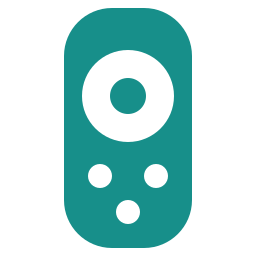
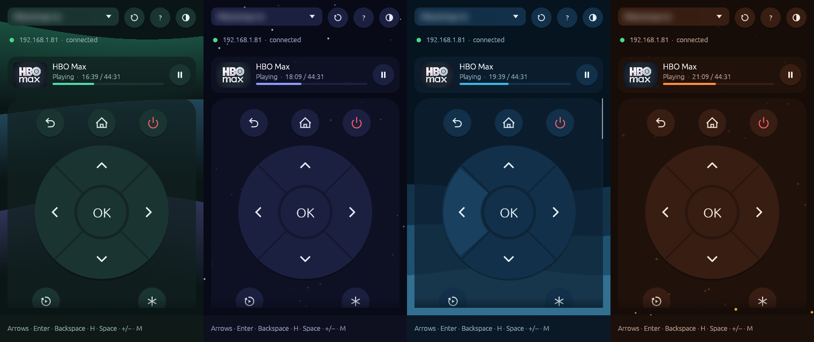

# Sofa Remote

A small desktop remote for Roku TVs and streaming players on your home network, for Linux (AppImage or Flatpak) and Windows (.exe). Written in Rust with [egui](https://github.com/emilk/egui).

Formerly called Roku Remote.

> **Unofficial.** This is an independent project, not affiliated with, endorsed by or sponsored by Roku, Inc. Roku is a trademark of Roku, Inc.; YouTube is a trademark of Google LLC.





The four animated themes: Aurora, Starlight, Tide and Ember. [Watch them move](docs/animated-themes.mp4) (8-second clip).

## Features

- **Finds your Rokus automatically** (SSDP), or connect by IP address. Remembers the last device.
- **Full remote:** Power, Home, Back, Options, D-pad and OK, Replay, Rewind, Play/Pause, Fast-forward.
- **TV controls** (Roku TVs only): Volume up/down/mute with the current level and a slider to set it, channel up/down, HDMI 1–4, AV and Antenna inputs, and separate TV on and TV off buttons.
- **Hold to repeat:** hold an arrow, volume or channel button and it keeps going.
- **Sleep timer** (Roku TVs only): turn the TV off in 30, 60 or 90 minutes. It keeps counting with the window closed to the tray.
- **Find remote:** makes the Roku remote beep, on devices that support it.
- **Type into search boxes** from your keyboard instead of the on-screen keyboard. Tick **Send each key as I type** and letters and Backspace reach the TV as you press them.
- **Search the TV:** type a movie or show and press the magnifier to open the TV's own search, which looks across every channel.
- **Wake TV:** if the TV has gone to sleep and off the network, the power button (or **Wake TV** at startup) wakes it over the network, on TVs that support it.
- **Update notice:** tells you when a newer version is out. It asks GitHub once at startup and sends nothing about you or your TV; switch it off under Appearance.
- **Channel launcher:** a button for every installed channel. Type in **Filter** to narrow the list, and right-click a channel to pin it to the top.
- **Now playing:** the current channel, play state and progress, in the window and the title bar.
- **Play YouTube links:** paste a YouTube link (watch, youtu.be, Shorts or live) with **Ctrl+V** and the TV's YouTube channel opens and plays it. (Right-click paste doesn't work in the app's text boxes.)
- **Share media:** pick a folder and play its videos, music and photos on the TV with Roku's free **Roku Media Player** channel. The **?** button explains the setup, checks that Media Player is on the TV and warns if a firewall may keep the TV out. The tray can start and stop sharing too.
- **Appearance:** six color themes (Violet, Ocean, Forest, Sunset, Rose, Graphite) and four animated ones with a moving background (Aurora, Starlight, Tide, Ember), plus a switch for animated buttons. Your choice is remembered.
- **Fits the window:** drag the window wider and the remote rearranges into two or three columns.
- **Linux desktop integration:**
  - **Tray icon:** play/pause, volume, mute, power, the sleep timer, routines and switching TVs without opening the window. Scroll on the icon to change the volume; click it to show or hide the remote. Closing the window keeps the remote in the tray.
  - **Media controls:** the TV appears in your desktop's media controls (COSMIC, GNOME, KDE) with the channel's logo, and your keyboard's media keys control it.
- **Routines:** several steps in one click, like TV on, HDMI 1, volume 20. Make them with **Edit** under Routines; run them from the window, the tray or a command.
- **Mini mode:** the **Mini** button shrinks the window to a small strip with play and volume that stays above other windows (on Wayland, pin it yourself from the title bar; apps can't there).
- **Start at login,** tucked in the tray (switch under Appearance), and a panel with the TV's model, software and network behind the **?** button.
- **Commands for your own shortcuts:** `sofa-remote --key Mute`, `--volume 20`, `--launch 12` or `--routine "Movie night"` go straight to the TV connected last, so you can bind them to global keyboard shortcuts in your desktop's settings. `sofa-remote --help` lists the keys.
- **Keyboard shortcuts:**

  | Key | Action |
  |---|---|
  | Arrow keys | D-pad |
  | Enter | OK |
  | Backspace / Esc | Back |
  | H | Home |
  | Space | Play/Pause |
  | `,` / `.` | Rewind / Fast-forward |
  | R | Instant replay |
  | I | Options |
  | `+` / `-` | Volume up / down |
  | M | Mute |
  | Page Up / Page Down | Channel up / down |

## Setting up your Roku

Newer Roku firmware only accepts volume commands from the network by default. On each TV, go to:

**Settings > System > Advanced system settings > Control by mobile apps > Network access** and choose **Enabled**.

If a TV is still on Limited, the app tells you when you connect. The **?** button at the top of the app shows these steps too.

## Run it

Download from the [latest release](https://github.com/billy1204/sofa-remote/releases/latest), or build it yourself (below).

**Linux:** download `Sofa-Remote-x86_64.AppImage`, then:

```bash
chmod +x Sofa-Remote-x86_64.AppImage
./Sofa-Remote-x86_64.AppImage
```

**Linux (Flatpak):** to run it sandboxed instead, download `Sofa-Remote-x86_64.flatpak`, then:

```bash
flatpak install --user Sofa-Remote-x86_64.flatpak
flatpak run io.github.billy1204.sofa-remote
```

This needs [Flatpak with Flathub set up](https://flathub.org/setup), which supplies the runtime. It doesn't update itself; install the newer file to update.

**Windows:** download `Sofa-Remote-windows-x86_64.exe` and double-click it. It's not code-signed, so Windows SmartScreen may warn you the first time; choose **More info > Run anyway**. If Windows Firewall asks, allow it on private networks so it can find your Rokus.

Your computer and the Roku must be on the same network.

### Sharing media

Install **Roku Media Player** on the TV (Home > Streaming Store > Roku Media Player > Add channel). Then click **Share a folder…** in the app. Media Player opens on the TV; choose **Sofa Remote (*your computer's name*)** and browse with the Roku remote.

A video's subtitles are offered to the TV when a `.srt` or `.vtt` file with the same name sits beside it, and a `.jpg` or `.png` with the same name (or `folder.jpg` in a folder) is offered as its picture.

The share is read-only, and only the folder you pick is visible. It answers only devices on your local network, never the internet, but anyone on the *same* network can browse it while it's shared (DLNA has no passwords). Share at home, not on public Wi-Fi, and press **Stop** when you're done.

If the TV can't see your computer, a firewall may be blocking it. The app detects ufw, firewalld and Windows Firewall and shows how to let the TV in (TCP ports 8200–8209 and UDP port 1900).

## Build

Requires a Rust toolchain (edition 2024) and [appimagetool](https://github.com/AppImage/appimagetool).

```bash
cargo run --release                       # run directly
cargo test                                # run the tests
APPIMAGETOOL=/path/to/appimagetool packaging/build_appimage.sh   # build the AppImage
packaging/build_flatpak.sh                # build the .flatpak from the release the manifest names
```

The Flatpak build needs `flatpak install --user flathub org.flatpak.Builder`.

After changing dependencies, run `packaging/licenses.sh` (needs `cargo install cargo-about --locked --features cli`) to regenerate [THIRD-PARTY-LICENSES.md](THIRD-PARTY-LICENSES.md).

On Windows, `cargo build --release` produces `target\release\sofa-remote.exe`. Publishing a GitHub release also builds the `.exe` and attaches it automatically ([workflow](.github/workflows/windows.yml)).

## How it works

It uses Roku's [External Control Protocol](https://developer.roku.com/docs/developer-program/dev-tools/external-control-api.md): plain HTTP requests to port 8060 on the device, which can press keys, launch channels (including YouTube with a video), and report what's playing.

| File | What's in it |
|---|---|
| [`src/main.rs`](src/main.rs) | The window: remote, now playing, YouTube box, sharing card and help panels |
| [`src/core.rs`](src/core.rs) | The background worker and state that outlive the window: network commands, the now-playing poll, saved settings |
| [`src/ecp.rs`](src/ecp.rs) | Talking to the Roku: discovery (SSDP), keys, channels, now playing, YouTube links |
| [`src/share.rs`](src/share.rs) | The media share: a small read-only DLNA server for Roku Media Player, and the firewall check |
| [`src/pick.rs`](src/pick.rs) | The folder picker (the desktop portal on Linux, the system dialog on Windows) |
| [`src/tray.rs`](src/tray.rs), [`src/mpris.rs`](src/mpris.rs) | Linux only: the tray icon, and desktop media controls over D-Bus |
| [`src/look.rs`](src/look.rs) | Colours, icons and the remote's buttons |

## Contributing

Bug reports and pull requests are welcome. Please follow the [Code of Conduct](CODE_OF_CONDUCT.md).

## License

[MIT](LICENSE). The app includes open-source libraries, fonts, Rust's standard library and (in the AppImage) the AppImage runtime, under their own licenses; their notices are in [THIRD-PARTY-LICENSES.md](THIRD-PARTY-LICENSES.md), which also ships inside the AppImage and with each release.

Roku is a trademark of Roku, Inc., and YouTube a trademark of Google LLC, used here only to say what the app works with. This project is not affiliated with or endorsed by either company.
